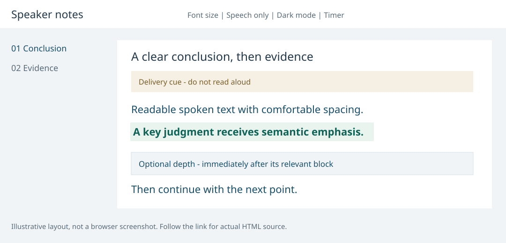

# Product Talk Script

[简体中文](README.md) | [English](README.en.md)

An agent skill for writing audience-aware product talks from existing material, with an offline HTML speaker view.

For software, physical products, services and platforms. The audience, communication goal and product stage determine the structure, presentation approach and level of detail.

[](examples/physical-product.html)

Illustrative layout. The link opens a downloadable HTML source file; open it locally in a browser.

## Capabilities

- Choose an appropriate approach for updates, decision reviews, pitches, user introductions, internal briefings and training.
- Read complete source material, including collapsed explanations, notes, charts and revisions. Keep essential reasoning in the main talk.
- Separate spoken prose, delivery cues and emphasis. Place optional explanations directly after the relevant block.
- Render self-contained HTML using the Python standard library: navigation, font controls, dark mode, timing, printing, Chinese/English UI and multicolor/monochrome emphasis.

The host AI assistant performs writing and semantic judgment. The renderer does not call a model or interpret business documents itself.

## Install and invoke

Download and extract the skill, then enter the directory containing `SKILL.md`. Python 3 is required. The installer copies local files, refuses existing destinations and does not change agent permissions.

| Tool | User-level directory | Project-level directory | Invocation / official documentation |
| --- | --- | --- | --- |
| Codex | `~/.agents/skills/product-talk-script/` | `.agents/skills/product-talk-script/` | `$product-talk-script`; [docs](https://learn.chatgpt.com/docs/build-skills) |
| Claude Code | `~/.claude/skills/product-talk-script/` | `.claude/skills/product-talk-script/` | `/product-talk-script`; [docs](https://code.claude.com/docs/en/skills) |
| Cursor | `~/.cursor/skills/product-talk-script/` | `.cursor/skills/product-talk-script/` | Name the skill in Agent chat or select it from `/`; [docs](https://cursor.com/docs/skills) |
| GitHub Copilot | `~/.copilot/skills/product-talk-script/` | `.github/skills/product-talk-script/` | Request it in an Agent surface that supports skills; [docs](https://docs.github.com/en/copilot/how-tos/copilot-on-github/customize-copilot/customize-cloud-agent/add-skills) |
| OpenCode | `~/.config/opencode/skills/product-talk-script/` | `.opencode/skills/product-talk-script/` | Ask the agent to load it with the skill tool; [docs](https://opencode.ai/docs/skills/) |

Choose the relevant user-level command:

```sh
python3 scripts/install_local.py --tool codex
python3 scripts/install_local.py --tool claude-code
python3 scripts/install_local.py --tool cursor
python3 scripts/install_local.py --tool copilot
python3 scripts/install_local.py --tool opencode
```

For a shared project installation, place the extracted `product-talk-script/` folder at the target project's root, then run:

```sh
python3 product-talk-script/scripts/install_local.py --tool claude-code --scope project --project .
```

Replace `claude-code` with the relevant tool. Use `--destination` for a custom final skill folder. Directory conventions were checked against the linked official documentation on 2026-10-14. Local-copy tests pass; this is not end-to-end validation in every host. Cloud agents may require project files or separate synchronization.

Older or differently configured Codex distributions may use another skill directory; use `--destination` for that configuration. Avoid duplicate installations under the same name. `agents/openai.yaml` is optional Codex UI metadata; other hosts can ignore it. Core instructions, references and rendering do not depend on it.

For tools without native skills support, ask the assistant to read `SKILL.md` and its relevant references as task instructions. This is manual use, not automatic discovery. HTML generation requires file access and Python execution; prose-only drafting does not require the renderer.

The prompts below use Codex syntax. For other tools, use their invocation method above or name the skill in natural language:

```text
Use $product-talk-script. This is a ten-minute progress update for stakeholders
who already know the product. Focus on changes, evidence, risks and decisions.
Keep Q&A separate and produce an HTML speaker view.
```

```text
Use $product-talk-script to introduce a physical product to first-time users.
Explain value through concrete use situations and clearly distinguish concept
benefits from tested results.
```

## Try the renderer without an AI assistant

These are fictional examples, not customer data or evidence of actual performance.

```sh
python3 scripts/render_speaker_html.py --input examples/service-review.json --output demo-service.html
python3 scripts/render_speaker_html.py --input examples/physical-product.json --output demo-product.html
```

Open the resulting files in a browser. The first demonstrates a Chinese service review with multicolor emphasis. The second demonstrates an English physical-product introduction with monochrome emphasis. Optional depth appears at its relevant point in the talk.

[Service review input](examples/service-review.json) · [Physical product input](examples/physical-product.json)

## Workflow and documentation

Communication context → complete source understanding → narrative choice → spoken prose and optional depth → factual/timing review → HTML.

- [Skill entry point](SKILL.md)
- [Scenario selection](references/scenarios.md)
- [Material and product analysis](references/materials.md)
- [HTML input format](references/html-delivery.md)

Core instructions are currently written in Chinese. Output language follows the user or source language. HTML includes Chinese and English UI; other language tags retain document language and use English UI. Typography and colors are defaults, not product-brand requirements. The product's own lifecycle, tasks and evidence standards determine its narrative.

## Run tests

```sh
python3 -m unittest discover -s tests -v
```

## Validation and privacy

Checks cover variable chapter counts, inline optional depth, timing budgets, escaping, IDs and emphasis, plus Chinese/English and service/physical-product inputs. Structural tests do not prove independent writing quality across scenarios or complete visual and interaction testing across browsers.

The renderer does not upload material. Source-processing data policies depend on the host assistant and model. Public examples contain no private project data.

## Provenance and license

The spoken-prose, delivery-cue and transition approach was inspired by [lecture-deck](https://github.com/RinDig/lecture-deck-skill). Instructions and rendering code were written independently and require neither its code nor installation.

Code and documentation are provided under the [MIT License](LICENSE). Users remain responsible for source rights and factual claims.
