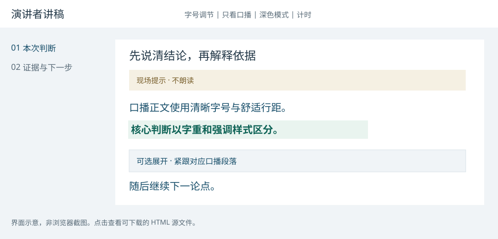

# Product Talk Script

[简体中文](README.md) | [English](README.en.md)

根据沟通场景、听众熟悉度与目标，从已有材料生成专业、具象、能直接讲的产品讲稿，并输出离线 HTML 演讲者页面。

适用于软件、实体产品、服务和平台。根据听众、沟通目标与产品阶段，选择合适的内容结构、演讲方法和表达深度。

[](examples/service-review.html)

界面示意；链接指向可下载的 HTML 源文件，下载后用浏览器打开。

## 能做什么

- 为阶段汇报、决策评审、路演、用户介绍、内部串讲和培训选择不同叙事方法。
- 理解完整输入，包括折叠说明、备注、图表与版本变化；重要论证进入主讲。
- 将口播、现场提示和重点分层，深入讲解在对应段落后就地展开。
- 用 Python 标准库生成自包含 HTML：章节导航、字号、深色模式、计时、打印、中文/英文界面及多色/单色强调。

写作与内容判断由支持 skill 的 AI 助手完成；渲染器不调用模型，也不会自行读取或理解原始业务文档。

## 安装与调用

下载并解压，进入含 `SKILL.md` 的目录。需要 Python 3；安装脚本只复制本地文件，目标目录已存在时停止，不覆盖，也不修改工具权限。

| 工具 | 用户级目录（跨项目） | 项目级目录 | 调用方式 / 官方说明 |
| --- | --- | --- | --- |
| Codex | `~/.agents/skills/product-talk-script/` | `.agents/skills/product-talk-script/` | `$product-talk-script`；[官方文档](https://learn.chatgpt.com/docs/build-skills) |
| Claude Code | `~/.claude/skills/product-talk-script/` | `.claude/skills/product-talk-script/` | `/product-talk-script`；[官方文档](https://code.claude.com/docs/en/skills) |
| Cursor | `~/.cursor/skills/product-talk-script/` | `.cursor/skills/product-talk-script/` | 在 Agent 对话中明确指定技能，或从 `/` 菜单选择；[官方文档](https://cursor.com/docs/skills) |
| GitHub Copilot | `~/.copilot/skills/product-talk-script/` | `.github/skills/product-talk-script/` | 在支持 skills 的 Agent 场景中请求使用该技能；[官方文档](https://docs.github.com/en/copilot/how-tos/copilot-on-github/customize-copilot/customize-cloud-agent/add-skills) |
| OpenCode | `~/.config/opencode/skills/product-talk-script/` | `.opencode/skills/product-talk-script/` | 请求使用该技能，由 Agent 通过 skill 工具加载；[官方文档](https://opencode.ai/docs/skills/) |

任选一个对应的用户级安装命令：

```sh
python3 scripts/install_local.py --tool codex
python3 scripts/install_local.py --tool claude-code
python3 scripts/install_local.py --tool cursor
python3 scripts/install_local.py --tool copilot
python3 scripts/install_local.py --tool opencode
```

要让项目成员共享技能，用项目级安装。例如在目标项目根目录保存解压后的 `product-talk-script/` 文件夹，然后运行：

```sh
python3 product-talk-script/scripts/install_local.py --tool claude-code --scope project --project .
```

将 `claude-code` 换成相应工具即可。自定义目录用 `--destination` 指向最终技能文件夹。目录与发现方式按以上官方文档核对于 2026-10-14；本地复制测试通过，但不代表每个工具均已完成运行验证。云端 Agent 可能需要项目级文件或额外同步，不能仅凭本机用户级安装认为云端已可用。

Codex 较旧版本或不同发行版的技能目录可能不同；请按其实际配置使用 `--destination`。不要同时安装多份同名技能。`agents/openai.yaml` 是 Codex 的可选界面元数据，其余宿主可忽略；核心 `SKILL.md`、脚本和参考文件不依赖它。

未提供原生 skills 机制的工具，可以让助手读取 `SKILL.md` 和相关参考文件作为任务指导；这不等同于安装后自动发现。生成 HTML 还要求环境允许读取文件并运行 Python。若只需要口播文字，不必执行渲染器。

以下是 Codex 调用示例；其他工具按上表使用相应调用方式，或自然语言指定技能名：

```text
请使用 $product-talk-script。这次面向熟悉产品的负责人做阶段汇报，
10 分钟，问答另计。根据附件重点讲变化、证据、风险与待决策事项，输出 HTML。
```

```text
请使用 $product-talk-script。向第一次接触这款实体产品的用户介绍，
用具体体验解释价值与采用条件，明确区分产品概念和测试结果。
```

## 无需 AI，先体验 HTML 渲染

以下是虚构演示数据，没有客户资料或实际效果承诺。

```sh
python3 scripts/render_speaker_html.py --input examples/service-review.json --output demo-service.html
python3 scripts/render_speaker_html.py --input examples/physical-product.json --output demo-product.html
```

用浏览器打开生成的文件。第一个是中文服务评审、多色强调；第二个是英文实体产品介绍、单色强调。展开框位于对应口播段落之后。

[服务评审输入](examples/service-review.json) · [实体产品介绍输入](examples/physical-product.json)

## 工作方式

场景判断 → 全文理解 → 选择叙事与演讲技巧 → 口播及可选深度 → 复核事实/时间 → HTML。

- [技能入口](SKILL.md)
- [场景与技巧选择](references/scenarios.md)
- [材料理解与产品维度](references/materials.md)
- [HTML 数据格式与命令](references/html-delivery.md)

输出语言按用户要求或输入语言。HTML 内置中文与英文界面；其他语言标签保留文档语言并使用英文界面。默认配色可以替换，也可选单色。以后的项目应由自身的用户任务、生命周期与证据标准决定结构。

## 运行测试

```sh
python3 -m unittest discover -s tests -v
```

## 验证范围

已检查动态章节、段内展开位置、计时预算、文本转义、ID 与重点合法性，以及中文/英文、服务/实体产品输入。结构测试不等于不同场景的讲稿质量已经获得独立验证，也不代表已经完成全部浏览器交互与视觉测试。

原始材料可能包含非公开信息：示例为虚构数据；渲染器不会上传资料。AI 助手处理材料的数据政策仍取决于所用宿主和模型。

## 来源与许可

借鉴 [lecture-deck](https://github.com/RinDig/lecture-deck-skill) 的口播、提示与转场组织思路，指令与渲染实现独立编写，不依赖其代码或安装。

本项目代码与文档按 [MIT License](LICENSE) 提供。使用者仍应对输入材料的使用权和输出事实负责。
